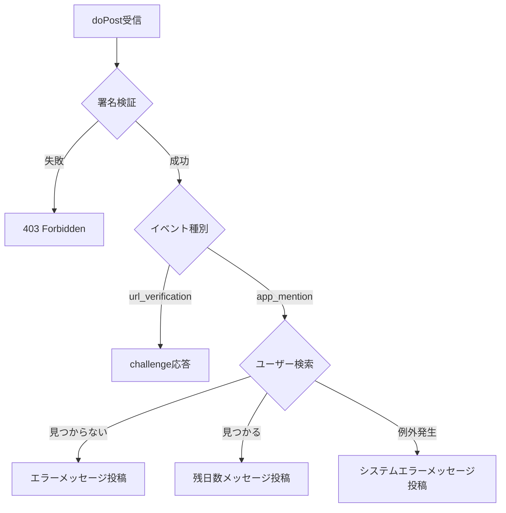

# 設計書: 有給残日数問い合わせSlackbot

## 1. システム構成図

```mermaid
graph TB
    subgraph Slack
        A[User: @oyasumi_inquiry] --> B[Slack Event API]
    end

    subgraph "Google Apps Script"
        B --> C[doPost - Webhook Handler]
        C --> D[verifySlackSignature]
        C --> E[handleAppMention]
        E --> F[findPaidLeaveBalance]
        F --> G[postSlackMessage]
    end

    subgraph "Google Sheets"
        F --> H[(有給管理表シート)]
    end

    G --> B
```



## 2. モジュール設計

### 2.1 Code.gs（メインエントリポイント）

```typescript
// Webアプリのエントリポイント
function doPost(e: GoogleAppsScript.Events.DoPost): GoogleAppsScript.Content.TextOutput
```

### 2.2 slackHandler.gs（Slack処理）

```typescript
// Slack署名検証
function verifySlackSignature(
  timestamp: string,
  body: string,
  signature: string
): boolean

// app_mentionイベント処理
function handleAppMention(event: SlackAppMentionEvent): void

// Slackへメッセージ投稿
function postSlackMessage(
  channel: string,
  text: string,
  threadTs: string
): void
```

### 2.3 sheetHandler.gs（スプレッドシート処理）

```typescript
// ユーザーの有給残日数を検索
function findPaidLeaveBalance(slackUserId: string): number | null
```

### 2.4 config.gs（設定管理）

```typescript
// Script Propertiesから設定を取得
function getConfig(): Config

interface Config {
  SLACK_BOT_TOKEN: string
  SLACK_SIGNING_SECRET: string
  SPREADSHEET_ID: string
  SHEET_NAME: string
}
```

## 3. データフロー

### 3.1 リクエスト処理フロー

1. Slackからのイベントを`doPost`で受信
2. URL Verification challengeの場合は即時応答
3. 署名検証を実行
4. `app_mention`イベントを処理
5. スプレッドシートからデータ取得
6. Slack APIでスレッド返信

### 3.2 エラーハンドリングフロー



## 4. 設定項目（Script Properties）

| プロパティ名 | 説明 | 例 |
|-------------|------|-----|
| SLACK_BOT_TOKEN | Slack Bot OAuth Token | xoxb-xxxx |
| SLACK_SIGNING_SECRET | Slack Signing Secret | xxxxxxx |
| SPREADSHEET_ID | 対象スプレッドシートID | 1HpeLLzMprhRCKX1Xc_9FjjAOEODEYl4-ISSQh3pHGWs |
| SHEET_NAME | 対象シート名 | 有給管理表シート |

## 5. API仕様

### 5.1 Slack Event API（受信）

```json
{
  "type": "event_callback",
  "event": {
    "type": "app_mention",
    "user": "U01234567",
    "text": "<@UBOT123> 残日数教えて",
    "channel": "C01234567",
    "ts": "1234567890.123456"
  }
}
```

### 5.2 Slack chat.postMessage（送信）

```json
{
  "channel": "C01234567",
  "text": "有給休暇の残日数は15日となります！",
  "thread_ts": "1234567890.123456"
}
```

## 6. セキュリティ設計

### 6.1 署名検証ロジック

```
baseString = "v0:" + timestamp + ":" + requestBody
signature = "v0=" + HMAC-SHA256(signingSecret, baseString)
```

### 6.2 タイムスタンプ検証
- リクエストのタイムスタンプが5分以内であることを確認

## 7. ファイル構成

```
Paidleave_inquiry/
├── src/
│   ├── Code.ts          # メインエントリポイント
│   ├── slackHandler.ts  # Slack処理
│   ├── sheetHandler.ts  # スプレッドシート処理
│   ├── config.ts        # 設定管理
│   └── types.ts         # 型定義
├── appsscript.json      # GAS設定
├── .clasp.json          # clasp設定
└── README.md            # セットアップ手順
```
