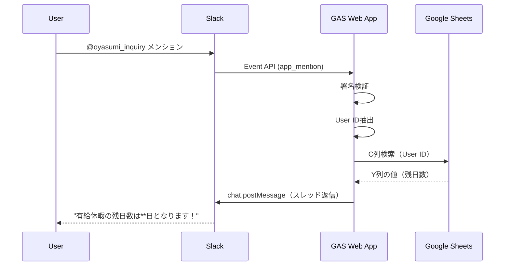

# 要件定義: 有給残日数問い合わせSlackbot

## 概要
Slackで特定のbotをメンションすると、呼び出したユーザーの有給残日数をGoogleスプレッドシートから取得し、スレッドに返信するbot。

## 機能要件

### FR-01: Slackメンション検知
- **概要**: 特定チャンネルでのbotメンション（@oyasumi_inquiry）を検知
- **入力**: Slack Event API（app_mention イベント）
- **出力**: イベント情報（ユーザーID、チャンネルID、メッセージTS）

### FR-02: ユーザー情報取得
- **概要**: メンションしたユーザーのSlack User IDを取得
- **入力**: Slack Event payload
- **出力**: Slack User ID（例: U01234567）

### FR-03: スプレッドシート検索
- **概要**: 有給管理表シートからユーザーの有給残日数を検索
- **データソース**: https://docs.google.com/spreadsheets/d/1HpeLLzMprhRCKX1Xc_9FjjAOEODEYl4-ISSQh3pHGWs/
- **シート名**: 有給管理表シート
- **検索キー**: C列（Slack User ID）
- **取得値**: Y列（有給残日数）

### FR-04: スレッド返信
- **概要**: 検索結果をスレッドの子メッセージとして投稿
- **成功時メッセージ**: "有給休暇の残日数は**日となります！"（**は残日数）
- **未登録時メッセージ**: "ユーザー情報が見つかりませんでした。管理者にお問い合わせください。"

## 非機能要件

### NFR-01: 応答時間
- メンションから返信まで3秒以内

### NFR-02: セキュリティ
- Slack署名検証（X-Slack-Signature）を実装
- Bot TokenはScript Propertiesで管理

### NFR-03: エラーハンドリング
- スプレッドシートアクセスエラー時のフォールバック
- 適切なエラーメッセージの返信

## 技術構成

### アーキテクチャ
```
Slack (app_mention) → GAS Web App (doPost) → Google Sheets API → Slack API (chat.postMessage)
```

### 必要なSlack権限（Bot Token Scopes）
- `app_mentions:read` - メンション検知
- `chat:write` - メッセージ投稿
- `users:read` - ユーザー情報取得（任意）

### 必要なGAS権限
- Google Sheets API
- External HTTP requests (UrlFetchApp)

## データ構造

### スプレッドシート構造（有給管理表シート）
| 列 | 内容 |
|----|------|
| C列 | Slack User ID |
| Y列 | 有給残日数 |

## 処理フロー


