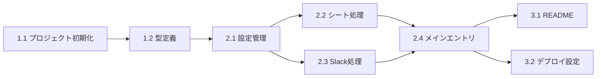

# タスクリスト: 有給残日数問い合わせSlackbot

## Phase 1: プロジェクトセットアップ

### Task 1.1: GASプロジェクト初期化
- [ ] package.json作成
- [ ] TypeScript設定（tsconfig.json）
- [ ] Rollup設定（rollup.config.mjs）
- [ ] appsscript.json作成

### Task 1.2: 型定義作成
- [ ] Slack Event API型定義
- [ ] 設定インターフェース型定義

## Phase 2: コア機能実装

### Task 2.1: 設定管理モジュール
- [ ] config.ts - Script Properties取得関数

### Task 2.2: スプレッドシート処理モジュール
- [ ] sheetHandler.ts - findPaidLeaveBalance関数

### Task 2.3: Slack処理モジュール
- [ ] slackHandler.ts - verifySlackSignature関数
- [ ] slackHandler.ts - handleAppMention関数
- [ ] slackHandler.ts - postSlackMessage関数

### Task 2.4: メインエントリポイント
- [ ] Code.ts - doPost関数

## Phase 3: ドキュメント・デプロイ準備

### Task 3.1: README作成
- [ ] セットアップ手順
- [ ] Slack App設定手順
- [ ] Script Properties設定手順

### Task 3.2: デプロイ設定
- [ ] clasp設定ファイル作成

## 依存関係

## 見積もり

| Phase | タスク数 |
|-------|---------|
| Phase 1 | 2タスク |
| Phase 2 | 4タスク |
| Phase 3 | 2タスク |
| **合計** | **8タスク** |
