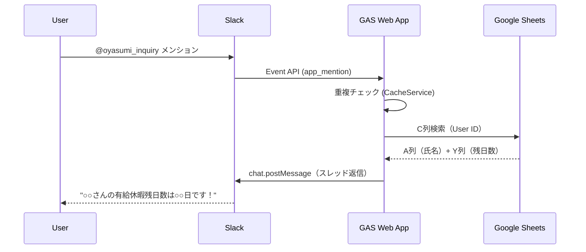

# 有給残日数問い合わせ Slackbot (oyasumi_inquiry)

Slackで `@oyasumi_inquiry` をメンションすると、呼び出したユーザーの有給残日数をスレッドに返信するbotです。

## 機能

- Slackメンションによる有給残日数の照会
- ユーザー名付きの返信メッセージ
- 重複リアクション防止（Slackリトライ対策）
- スレッド返信による通知

## システム構成



## リソース情報

| リソース | ID/URL |
|---------|--------|
| Apps Script | `1wz0kPm561eJnCoNDFRayKhtYOXMwJM7cVQSNOdtc2vX53R1O-GBXo_07` |
| Apps Script Editor | [開く](https://script.google.com/d/1wz0kPm561eJnCoNDFRayKhtYOXMwJM7cVQSNOdtc2vX53R1O-GBXo_07/edit) |
| 参照スプレッドシート | `1HpeLLzMprhRCKX1Xc_9FjjAOEODEYl4-ISSQh3pHGWs` |
| 参照シート名 | `有給管理表` |

## ファイル構成（Apps Script）

| ファイル | 説明 |
|----------|------|
| `Code.gs` | メインエントリポイント（doPost/doGet）、重複防止ロジック |
| `SlackHandler.gs` | Slack処理（handleAppMention/postSlackMessage） |
| `SheetHandler.gs` | スプレッドシート検索（findPaidLeaveBalance） |
| `Config.gs` | 設定管理（getConfig/setConfig） |
| `Test.gs` | テスト関数 |

## セットアップ手順

### 1. Slack Appの作成

1. [Slack API](https://api.slack.com/apps) にアクセス
2. 「Create New App」→「From scratch」を選択
3. App名: `oyasumi_inquiry`、Workspaceを選択して作成

### 2. Bot Token Scopesの設定

**OAuth & Permissions** で以下のスコープを追加:

| スコープ | 説明 |
|---------|------|
| `app_mentions:read` | メンション検知 |
| `chat:write` | メッセージ投稿 |

### 3. GAS Webアプリのデプロイ

1. [Apps Script Editor](https://script.google.com/d/1wz0kPm561eJnCoNDFRayKhtYOXMwJM7cVQSNOdtc2vX53R1O-GBXo_07/edit) を開く
2. 右上の「デプロイ」→「新しいデプロイ」をクリック
3. 「種類を選択」→ ⚙ アイコン →「ウェブアプリ」を選択
4. 以下を設定:
   - 説明: `Initial deployment`
   - 次のユーザーとして実行: `自分`
   - アクセスできるユーザー: `全員`
5. 「デプロイ」をクリック
6. **表示されるWebアプリURLをコピー**（後で使用）

### 4. Script Propertiesの設定

1. Apps Script Editorで「プロジェクトの設定」（⚙アイコン）を開く
2. 「スクリプト プロパティ」セクションで以下を追加:

| プロパティ名 | 値 |
|-------------|-----|
| `SLACK_BOT_TOKEN` | Slack AppのBot User OAuth Token（`xoxb-...`） |
| `SLACK_SIGNING_SECRET` | Slack AppのSigning Secret |
| `SPREADSHEET_ID` | `1HpeLLzMprhRCKX1Xc_9FjjAOEODEYl4-ISSQh3pHGWs` |
| `SHEET_NAME` | `有給管理表` |

**Bot Token の取得方法:**
- Slack App管理画面 → **OAuth & Permissions** → **Bot User OAuth Token**

**Signing Secret の取得方法:**
- Slack App管理画面 → **Basic Information** → **App Credentials** → **Signing Secret**

### 5. Slack Event Subscriptionsの設定

1. Slack App管理画面 → **Event Subscriptions** を開く
2. 「Enable Events」を **On** に切り替え
3. **Request URL** に手順3でコピーしたWebアプリURLを貼り付け
   - 検証が成功すると「Verified」と表示される
4. **Subscribe to bot events** で「Add Bot User Event」をクリック
5. `app_mention` を追加
6. 「Save Changes」をクリック

### 6. Slack Appのインストール

1. **OAuth & Permissions** → **Install to Workspace** をクリック
2. 権限を確認して「許可する」

### 7. 動作確認

1. Slack Appを使用するチャンネルに `/invite @oyasumi_inquiry` で招待
2. チャンネルで `@oyasumi_inquiry` をメンション
3. スレッドに有給残日数が返信されることを確認

## データ構造

### 参照スプレッドシート（有給管理表シート）

| 列 | 内容 | 例 |
|----|------|-----|
| A列 | 氏名 | `神田 宏樹` |
| C列 | Slack User ID | `U02JLA69B1N` |
| Y列 | Bot照会用（有給残日数） | `49.0` |

## メッセージ仕様

| 条件 | メッセージ |
|------|-----------|
| ユーザー発見時 | `○○さんの有給休暇残日数は○○日です！` |
| ユーザー未登録時 | `あなたは有給休暇管理の対象外です。有給休暇管理の対象である場合は設定が完了していないので管理者へお問い合わせください。` |
| システムエラー時 | `システムエラーが発生しました。しばらくしてから再度お試しください。` |

## テスト関数

Apps Script Editorから以下の関数を実行してテスト可能:

| 関数 | 説明 |
|------|------|
| `testConfig()` | 設定確認 |
| `testFindPaidLeaveBalance()` | スプレッドシート検索テスト |
| `testDuplicatePrevention()` | 重複防止機能テスト |
| `testFullFlow()` | 全体フローテスト（Slack投稿なし） |

## トラブルシューティング

### 「あなたは有給休暇管理の対象外です」と表示される

- スプレッドシートのC列にSlack User IDが正しく登録されているか確認
- Slack User IDは `U` で始まる英数字（例: `U02JLA69B1N`）

### 返信が来ない

- Event SubscriptionsのRequest URLが正しく設定されているか確認
- Apps Script Editorの「実行数」で実行ログを確認
- Bot TokenとSigning Secretが正しく設定されているか確認

### 「Verified」にならない

- WebアプリのURLが正しいか確認（`/exec`で終わる）
- デプロイが完了しているか確認

### 複数回返信が来る

- 通常は重複防止機能で対策済み
- 問題が続く場合はApps Scriptの実行ログを確認

## 更新手順

コードを修正した場合:

1. Apps Script Editorでコードを編集
2. 「デプロイ」→「デプロイを管理」→「新しいバージョン」
3. 「デプロイ」をクリック

または、MCPツールを使用:
```
smart_update_webapp(script_id="1wz0kPm561eJnCoNDFRayKhtYOXMwJM7cVQSNOdtc2vX53R1O-GBXo_07")
```
